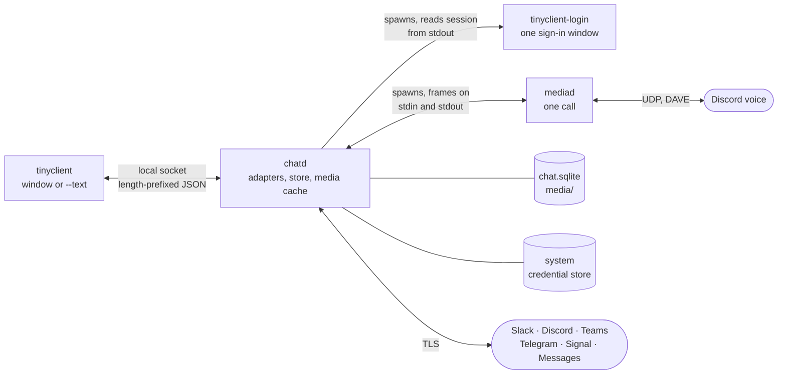

<div align="center">


# tinyclient

**One native app for Slack, Discord, Telegram, Teams, Signal, and Messages. Small, local, and open source.**

[](https://github.com/itz4blitz/tinyclient/actions/workflows/ci.yml)
[](https://github.com/itz4blitz/tinyclient/releases/latest)
[](LICENSE)

[Website](https://tinyclient.io) ·
[Discord](https://discord.gg/kJHK7BNvJP) ·
[Releases](https://github.com/itz4blitz/tinyclient/releases) ·
[Architecture](docs/architecture.md) ·
[Contributing](CONTRIBUTING.md) ·
[Security](SECURITY.md)

</div>

tinyclient is a chat client written in Rust. It signs in to Slack, Discord, Telegram, Microsoft Teams, Signal, and Android Messages, and shows them in one window with one design. It runs entirely on your machine. It talks to each network directly. There is no tinyclient server, and nothing you type is sent anywhere else. It is built for macOS, Linux, and Windows.

The project is early. The goal is a client that is a pleasure to use and does everything the official apps do, on every network, while staying small. Talk with us on [Discord](https://discord.gg/kJHK7BNvJP), or [come help](#contributing).

## Contents

- [Why](#why)
- [What works today](#what-works-today)
- [Work in progress](#work-in-progress)
- [Install](#install)
- [Keyboard shortcuts](#keyboard-shortcuts)
- [Build from source](#build-from-source)
- [Try it without an account](#try-it-without-an-account)
- [Architecture](#architecture)
- [Repository map](#repository-map)
- [Privacy and security](#privacy-and-security)
- [Networks and terms](#networks-and-terms)
- [Contributing](#contributing)
- [License](#license)

## Why

The official apps are several copies of a browser. tinyclient is one small daemon that holds the connections, and a native window that draws what the daemon reports.

- **Local first.** Messages are cached in SQLite on your disk. Sessions live in the system credential store. The only connections made are to the networks you sign in to.
- **No telemetry.** No analytics, no usage pings, no crash upload. A panic is written, with credentials redacted, to a `crash.log` on your disk and nowhere else. About once an hour the window asks GitHub whether a newer release exists. That request sends only `User-Agent: tinyclient/<version>`. With automatic install on, the new copy is checked and replaces this one when you quit.
- **Small, with budgets.** Every feature has a memory, speed, and idle-CPU budget it must pass, measured from outside the process ([`docs/product/07-budgets-and-risk.md`](docs/product/07-budgets-and-risk.md)). The target for the whole product, idle and signed in to four networks, is **150 MB**. Measured on 2026-10-13: `chatd` at 10 MB RSS signed in to Discord, the window at 64 MB RSS.
- **Calls cost nothing until you make one.** Voice runs in its own process, `mediad`, which exists only for the length of a call. No audio code is loaded the rest of the time.
- **Idle means idle.** Adapters block on their sockets and inboxes. The budget for `chatd` is about one wakeup a second for the whole process.
- **Native, not Electron.** The window is [GPUI](https://github.com/zed-industries/zed), Zed's UI framework. The only web page tinyclient ever shows is a network's own sign-in page, in a separate process that exits when you are in.
- **Never acts for you.** No adapter sends a reaction, edit, friend request, read receipt, or presence change you did not ask for. A conversation is marked read only when the window is active, the conversation is open, and the message is on screen.

Sizes of a macOS arm64 release build, 2026-10-14:

| Binary | Size | Runs |
| --- | --- | --- |
| `chatd` | 28 MB (Signal's libraries included) | always, in the background |
| `tinyclient` | 22 MB | while the window is open |
| `mediad` | 5.5 MB | during a call only |
| `tinyclient-login` | 1.8 MB | during a sign-in only |

## What works today

Current release: [v0.2.5](https://github.com/itz4blitz/tinyclient/releases/tag/v0.2.5). This is what `main` does. The goal is full parity with each official app. Every gap is a place to help.

| Network | Sign-in | Reading and media | Writing | Calls |
| --- | --- | --- | --- | --- |
| **Discord** | Discord's web sign-in page | Servers, channels, threads, DMs, friends with presence, avatars, images, files, GIFs, link cards, reactions, replies, pins, profiles | Text, replies, threads, files, reactions, edit, delete, friend requests, your own status, mute, leave | Voice in DMs and voice channels, with Discord's end-to-end encryption (DAVE). Stage channels are not joined. Audio only: no camera, no screen share. |
| **Slack** | Slack's web sign-in page. Every workspace of one sign-in. | Sections, channels, threads, DMs, avatars, files, GIFs, reactions, pins | Text, replies, files, reactions, edit, delete, your own status, mute | Huddles open in Slack |
| **Teams** | Microsoft's sign-in page. Work and school accounts only. | Teams, channels, chats, reply chains as threads, presence. Giphy GIFs play. | Text, files through OneDrive, reactions, edit, delete, mute | Calls and meetings open in Teams |
| **Telegram** | QR code from your phone, or a phone number and code, plus a 2FA password | Chats, folders, topics, photos, pins | Text, files, reactions, edit, delete, mute, leave | Calls open in Telegram |
| **Signal** | Linked as a device. Scan a QR code from your phone. | Direct and group chats, replies, mentions, reactions, edits, deletes. Photos and files appear as a labelled line. Nothing from before the link. Your own chat is **Note to Self**, including messages sent from your phone. | Text, replies, reactions, edit and delete your own | Not built |
| **Messages** | Paired from the Android phone, the way [messages.google.com](https://messages.google.com) is. The phone stays the account and has to stay online. | Texts in the chats the phone already has. Photos and files appear as a labelled line. | Text. Reactions are not in this version. | Opens in Messages |

A few behaviours that are easy to miss:

- **Animated images.** GIFs, animated WebP, and APNG play where pictures are drawn. Settings, under Messages, chooses when they play. A Slack GIF uses Slack's moving copy. A Teams GIF from the Giphy button is a GIF.
- **Discord's server list** waits until chats have loaded before it shows cached servers, so a cold start does not flash an empty or stale tree.
- **Signal's Note to Self.** A cached self-conversation is relabelled when the account reconnects. Its messages stay.
- **Search.** `tinyclient --text --search` searches message text in the local cache, newest hits first. The switcher still finds conversations by title. The window does not show those hits yet, and the networks themselves are not asked.
- **Terminal.** `tinyclient --text`, or any build without the `gui` feature, prints account status and the inbox as lines of text. An interactive terminal UI is not built. The socket protocol is enough to write one.
- **Platforms.** CI builds and tests macOS, Linux, and Windows on every push (`.github/workflows/ci.yml`). Most development happens on macOS, so reports and fixes from Linux and Windows are especially welcome. The main window closes cleanly on all three. Linux web sign-in, including Discord's session capture, works with WebKitGTK.

Still not built, and not covered by an open pull request: message search in the window, notifications and a dock badge, voice messages, Signal attachments and safety numbers, Messages reactions and shown photos, Teams personal accounts, and video or screen share (see [work in progress](#work-in-progress) for the Discord slice that is underway).

## Work in progress

Look at [open pull requests](https://github.com/itz4blitz/tinyclient/pulls) before you start something large. This is the queue as of 17 October 2026. Say which area you want on [Discord](https://discord.gg/kJHK7BNvJP) so two people do not build the same thing.

| Work | Where it stands |
| --- | --- |
| **Cached network sidebars** | [#10](https://github.com/itz4blitz/tinyclient/pull/10) keeps each network's home in memory for the GUI session, so switching away and back does not show "Getting your chats…" while the local daemon is reread. It conflicts with `main` after the Discord loading fix and needs a rebase that keeps both. |
| **Discord voice channels in the server list** | Voice works in a DM and in a channel you are already in. The server list does not yet show public or private voice channels, or let you join one from there. That is being built on top of `main`. |
| **Call audio** | Discord calls are Opus at 48 kHz. An underrun fades to silence and an over-full playback buffer fades across the samples it drops, so neither end hears a click from that buffer. Reopening the audio device runs off the 20 ms tick. Slack, Teams, Telegram, and Signal still hand the call to the official app. |
| **Camera and screen share** | Calls are audio only. The protocol already names video streams, and a voice occupant can show a monitor glyph when Discord says they are streaming or on camera. mediad does not decode or send video yet. Receive-only screen share is the first slice; sending a camera, then guild "Go Live", comes after. |

Recently merged, and already in the sections above: cached message search from `tinyclient --text --search`, installable packages, in-app updates, Android Messages, animated images, an optional systemd user service for `chatd`, Signal's Note to Self, recovery when the Linux keyring unlocks late, native shortcut labels, and sidebar previews that stay inside their row.

## Install

Download from [tinyclient.io](https://tinyclient.io), or from the [latest release](https://github.com/itz4blitz/tinyclient/releases/latest). The site's links go to the same GitHub release files. Each release is built in the open by `.github/workflows/release.yml` from a `v*` tag, with a `SHA256SUMS` file to check them against. Every package is installed and started on a clean system in that workflow before it is published.

| OS | Download | What it is |
| --- | --- | --- |
| macOS 13+, Apple silicon | [`tinyclient-macos.dmg`](https://tinyclient.io/download/macos) ([`.zip`](https://tinyclient.io/download/macos-zip)) | `tinyclient.app`, to drag to Applications |
| Debian, Ubuntu | [`tinyclient-linux-x86_64.deb`](https://tinyclient.io/download/deb) | `sudo apt install ./tinyclient-linux-x86_64.deb` |
| Fedora, openSUSE | [`tinyclient-linux-x86_64.rpm`](https://tinyclient.io/download/rpm) | `sudo dnf install ./tinyclient-linux-x86_64.rpm` |
| Any Linux | [`tinyclient-linux-x86_64.AppImage`](https://tinyclient.io/download/appimage) | One file: `chmod +x` it and run it |
| Any Linux | [`tinyclient-linux-x86_64.tar.gz`](https://tinyclient.io/download/linux-tar) | The four programs and `install.sh` (`~/.local`, or `--system`) |
| Windows 10+, x86_64 | [`tinyclient-windows-x86_64-setup.exe`](https://tinyclient.io/download/windows) | Installer for the current user. Apps & features uninstalls it. |
| Windows, portable | [`tinyclient-windows-x86_64.zip`](https://tinyclient.io/download/windows-portable) | The four `.exe` files, run in place |

Each Linux format is also built for arm64, named `aarch64` in place of `x86_64`. The `.deb` and `.rpm` bring in the libraries tinyclient needs. The AppImage and `.tar.gz` use the system's (GTK 3, WebKitGTK 4.1, ALSA, OpenSSL 3, Vulkan) and need glibc 2.35 or later.

The four programs stay in one directory. Each finds the others beside itself. Start `tinyclient`. It starts `chatd` when nothing answers on the socket.

[Getting started](https://tinyclient.io/docs/) has the install, check, and remove commands for each package.

- **macOS.** The app is signed ad hoc, not notarized, so Gatekeeper warns the first time you open it. Allow it in System Settings → Privacy & Security if you trust the build. Open the app rather than the bare binaries. macOS grants the microphone to an app bundle, so calls need the bundle.
- **Linux.** Sessions are kept in the Secret Service (GNOME Keyring, KWallet), which must be running with its keyring unlocked in your login session. With a standalone compositor such as dwl, configure the provider's startup and unlocking separately. Installing a provider does not unlock the session. KeePassXC also works when its Secret Service integration is enabled. Arch packages can require the virtual dependency `org.freedesktop.secrets` to accept any packaged provider. The sign-in window needs WebKitGTK 4.1 and supports Wayland and X11.
- **Windows.** The installer and programs are not code-signed, so SmartScreen warns before the first run (More info → Run anyway). The programs open without a console window and carry the app icon. The sign-in window needs WebView2, which current Windows includes. The window refuses to send files from Windows's protected folders, as it does on Unix.

### Updates

The window checks GitHub for a newer release about once an hour. It can download that release, check it, and replace this copy when you quit. The check sends only the version in the user agent.

### Optional systemd user service on Linux

The `.deb`, `.rpm`, and Arch package can install `tinyclient-chatd.service`. It is **disabled by default**. With the unit disabled, tinyclient starts its own daemon, logs to `chatd.log`, and stops the daemon when the application quits.

To let systemd manage the daemon, quit tinyclient first so its existing daemon releases the socket. Then, from a terminal in your graphical session:

```sh
systemctl --user daemon-reload
systemctl --user import-environment WAYLAND_DISPLAY DISPLAY XDG_CURRENT_DESKTOP
systemctl --user enable --now tinyclient-chatd.service
journalctl --user -u tinyclient-chatd.service -f
```

Import only the variables your session actually sets. Wayland normally sets `WAYLAND_DISPLAY`. X11 sets `DISPLAY`. If you use `XDG_DATA_HOME`, import that too so the GUI and daemon use the same data directory. Your Secret Service provider must be running and unlocked on the same user session bus.

When the unit is enabled, opening tinyclient asks systemd to start the daemon if needed. Quitting the GUI leaves the daemon receiving messages. The window's "Keep receiving" preference does not override the enabled service. Failed starts are reported without spawning a second, unmanaged daemon. Use `systemctl --user restart tinyclient-chatd.service` after upgrading the binaries. To stop background activity, quit the GUI and run `systemctl --user stop tinyclient-chatd.service`.

The unit follows `graphical-session.target`. Desktops that manage that target start and stop it with the graphical session. With dwl or another standalone compositor, import the display environment after the compositor starts, then start the service, and stop it when leaving the session. Repeat the environment import on each login so sign-in helpers use the current display. Do not enable lingering just for this service: sign-in windows need a live graphical session.

To return to automatic daemon startup, quit the GUI and run:

```sh
systemctl --user disable --now tinyclient-chatd.service
```

The managed daemon inherits the user manager's environment, not the GUI's. For sign-in diagnostics, import `TINYCLIENT_LOGIN_DEBUG=1` into the manager and restart the service, then reproduce sign-in while watching its journal:

```sh
TINYCLIENT_LOGIN_DEBUG=1 systemctl --user import-environment TINYCLIENT_LOGIN_DEBUG
systemctl --user restart tinyclient-chatd.service
# After diagnosing:
systemctl --user unset-environment TINYCLIENT_LOGIN_DEBUG
systemctl --user restart tinyclient-chatd.service
```

Those messages go to the journal without credentials. A standalone helper's stdout contains the session token. Redirect it to `/dev/null` when diagnosing, and never share it. A standalone helper does not attach an account to tinyclient. The Discord storage probe fixtures can be run with `node crates/login/tests/discord-probe.cjs`. Node.js is only needed for those fixtures.

Scratch runs (`TINYCLIENT_DIR`) and an explicit `TINYCLIENT_CHATD` always use direct startup. For source builds or archive installations, copy `packaging/linux/tinyclient-chatd.service` into `~/.config/systemd/user/`, change `ExecStart` to the absolute path of your installed `chatd`, and reload the user manager before enabling it. Keep the four executables together. AppImage users should use automatic daemon startup.

On Linux, a Secret Service provider may also need you to unlock GPG before it returns saved sessions. Background account loading retries short D-Bus read timeouts for up to two minutes. Unlock within that window and the accounts reconnect without signing in again. An explicit refusal, another error, or an expired retry window keeps the cached accounts and offers "Try again". Stored credentials are not deleted.

## Keyboard shortcuts

Shortcuts use Command on macOS and Ctrl on Linux and Windows. **Jump to…** is Command-K on macOS and Ctrl-K elsewhere. Menus, tooltips, and Settings → Keyboard Shortcuts show the keys for your platform. Super is left to the Linux desktop. Full screen uses Ctrl-Alt-F on Linux and Windows.

Text fields use the platform's editing keys: Ctrl-C, Ctrl-V, Ctrl-X, Ctrl-A, and Ctrl-Z on Linux and Windows, Ctrl-Left and Ctrl-Right to move by word, and Home and End to move within a line. The optional send shortcut is Ctrl-Enter there and Command-Return on macOS.

The shortcut list in Settings is read-only. To change a key, add it in the operating system's keyboard settings for this app.

## Build from source

Prerequisites:

- Rust, current stable, through [rustup](https://rustup.rs).
- `protoc` on the `PATH`. Signal's libraries compile protobufs at build time. macOS: `brew install protobuf`. Debian and Ubuntu: `apt install protobuf-compiler`. The Linux release build uses protoc 29.3, because Ubuntu 22.04's compiler is too old for Signal's protobufs.
- Linux only, the system libraries CI installs:

  ```sh
  sudo apt-get install build-essential pkg-config libssl-dev libasound2-dev libgtk-3-dev \
    libwebkit2gtk-4.1-dev libsoup-3.0-dev libvulkan-dev libwayland-dev libxkbcommon-dev libxkbcommon-x11-dev \
    libx11-dev libxcb1-dev libfontconfig1-dev protobuf-compiler
  ```

Then:

```sh
git clone https://github.com/itz4blitz/tinyclient
cd tinyclient
cargo test --workspace                     # every crate; no GPU stack
cargo build -p chatd -p mediad -p login    # the daemon and its helpers
cargo run -p tinyclient --features gui     # the window; starts chatd beside it
cargo run -p tinyclient                    # status and inbox as text
```

Develop against a scratch data directory, never your real one. See [Try it without an account](#try-it-without-an-account).

The downloads, as the release workflow makes them, into `dist/`:

```sh
packaging/bundle.sh && packaging/dmg.sh dist/tinyclient.dmg   # macOS: the app bundle and its disk image
eval "$(packaging/linux/tools.sh)" && packaging/linux.sh      # Linux: .deb, .rpm, AppImage, .tar.gz
packaging\windows.ps1                                         # Windows: the installer (Inno Setup 6) and .zip
```

Feature flags:

| Crate | Feature | Effect |
| --- | --- | --- |
| `chatd` | `signal` (default) | Links presage and libsignal (AGPL-3.0). `--no-default-features` leaves Signal unavailable. |
| `tinyclient` | `gui` | The GPUI window. Without it the binary prints status and the inbox as text. |
| `tinyclient` | `gui-shot` | Adds `--shot out.png`: render the window to a file and quit, for design review and driven tests. Such a shell never marks anything read. |

### Telegram needs your own app id

Telegram asks every client to register an app id, and the id is not in this repository. Register one at [my.telegram.org](https://my.telegram.org). The app name must not contain "Telegram". Build `chatd` with both values in the environment:

```sh
TINYCLIENT_TELEGRAM_API_ID=... TINYCLIENT_TELEGRAM_API_HASH=... cargo build -p chatd
```

Without them Telegram is listed as unavailable and says why. A binary built this way carries your id, and Telegram holds its owner responsible for what the app does. Give it to other people only if you accept that.

### Signal and the AGPL

The `signal` feature of `chatd` is on by default. It links [presage](https://github.com/whisperfish/presage), libsignal-service-rs, and Signal's libsignal, which are AGPL-3.0, so a `chatd` built with it is a combined work under the AGPL. The release binaries are built with it. `cargo build -p chatd --no-default-features` leaves Signal out.

## Try it without an account

`TINYCLIENT_DIR` moves the socket, database, and logs to a directory of your choosing and turns sign-in off, so nothing touches your keychain. `--seed-demo` fills that directory with invented servers, workspaces, people, and conversations: Discord, two Slack workspaces, Telegram, Teams, and Signal. `#showcase` holds every kind of message.

```sh
TINYCLIENT_DIR=/tmp/tinyclient-demo cargo run -p chatd -- --seed-demo
TINYCLIENT_DIR=/tmp/tinyclient-demo cargo run -p tinyclient --features gui
```

`--seed-demo=live` keeps one conversation busy: typing, a new message, a reaction, an edit. Other variants, comma separated: `expired`, `many` (50 Discord servers), `attention`, `reconnecting`. chatd refuses `--seed-demo` without `TINYCLIENT_DIR`, so it cannot write to your real store.

With `TINYCLIENT_DIR` set, sign-in runs only a helper a test names. The invented traffic is served by an adapter with no network behind it (`crates/chatd/src/demo/adapter.rs`). Variants and the timing knobs (`TINYCLIENT_DEMO_ANSWER_MS`, `TINYCLIENT_DEMO_UPLOAD_MS`, and the rest) are listed under "The demo" in [`docs/architecture.md`](docs/architecture.md).

## Architecture



| Crate | Binary | Role |
| --- | --- | --- |
| [`protocol`](crates/protocol) | | The contract: every request, answer, and change, as serde types. Frames are a 4-byte length, then JSON, at most 1 MiB, over a Unix socket (a named pipe on Windows). Also the panic hook, credential redaction, and how the shell starts chatd. |
| [`chatd`](crates/chatd) | `chatd` | Always on, one per data directory. One adapter per account speaks that network's protocol. Everything lands in SQLite and the media cache. Spawns `tinyclient-login` for a sign-in and `mediad` for a call. Never decodes media and never fetches a link from a message. |
| [`mediad`](crates/mediad) | `mediad` | Voice: Discord's voice gateway, RTP over UDP, Opus, DAVE, audio devices through cpal. Speaks only to chatd over stdin and stdout, and exits when the call ends or chatd closes its stdin. |
| [`login`](crates/login) | `tinyclient-login` | The sign-in page for Slack, Discord, and Teams in a native web view (WKWebView on macOS, wry elsewhere). Prints the session on stdout and exits. Signal, Telegram, and Messages pair in the main window. |
| [`tinyclient`](crates/tinyclient) | `tinyclient` | The shell. Draws what chatd reports and decodes images for rows on screen. GPUI is behind the `gui` feature so tests and the daemons never build a GPU stack. Never talks to a network or reads the database. |

The shell learns about changes by long-polling. `Wait {since}` blocks for up to 30 seconds and answers every change newer than `since`. The full contract, the data each process may hold, and what an adapter must do are in [`docs/architecture.md`](docs/architecture.md).

There is no adapter trait. An adapter is a module under `crates/chatd/src/adapters/` that exports three functions and talks to chatd through `Command` and `Context`. [CONTRIBUTING.md](CONTRIBUTING.md) walks through adding one.

## Repository map

| Path | What it is |
| --- | --- |
| [`crates/protocol`](crates/protocol) | Socket types shared by every process. A new field is optional, so an older frame still reads. |
| [`crates/chatd`](crates/chatd) | Adapters, the SQLite store, the media cache, and the demo. Network tests live in `crates/chatd/tests/`, with recorded traffic in `fixtures/`. |
| [`crates/mediad`](crates/mediad) | The call process. Call tests run it against a generated tone and a fake voice server. |
| [`crates/login`](crates/login) | The sign-in helper. |
| [`crates/tinyclient`](crates/tinyclient) | The window, the text shell, and the in-app updater. |
| [`docs/`](docs) | The spec: architecture, product stories, and the visual system. A choice the docs leave open is settled there, by agreement, before the code. |
| [`packaging/`](packaging) | The icon, the macOS bundle, Linux packages, the Windows installer, and the systemd unit. |
| [`site/`](site) | [tinyclient.io](https://tinyclient.io). Pages are static. A worker serves Markdown to clients that ask for it. |
| [`.github/workflows/`](.github/workflows) | CI on every push, the release workflow on a `v*` tag, and the site deploy. |

## Privacy and security

| What | Where | Protected by |
| --- | --- | --- |
| Sessions (tokens, cookies, Teams refresh tokens, Telegram keys) | macOS Keychain, Windows Credential Manager, or the Linux Secret Service. Service `tinyclient`, one item per network. | The OS credential store. Never written to the database or logs. |
| Signal keys, sessions, contacts, groups | `signal/<account>.state` in the data directory | Each value sealed with AES-256-GCM-SIV under a key that only the credential store item holds |
| Messages, conversations, people | `chat.sqlite` in the data directory | Not encrypted. Relies on disk encryption (FileVault, BitLocker, LUKS). |
| Avatars and attachments you looked at | `media/` in the data directory, capped at 500 MB | Not encrypted, as above |
| Crash reports and chatd's log | `crash.log`, `chatd.log` in the data directory | Credentials redacted before writing (`protocol::redact`). Never uploaded. |
| The sign-in window's browser data | A WebKit data store on macOS. `login/<network>/` in the data directory elsewhere. | Kept so an interrupted sign-in resumes |

The data directory is `~/Library/Application Support/tinyclient` on macOS, `$XDG_DATA_HOME/tinyclient` (default `~/.local/share/tinyclient`) on Linux, and `%APPDATA%\tinyclient` on Windows, or `TINYCLIENT_DIR` when set.

- **Network connections** go only to the networks you sign in to. Media is fetched only from each network's own hosts, an allow-list per network in `crates/chatd/src/blobs/fetch.rs`. Discord's GIF picker cells come from `media.tenor.com`, which Discord's own search returns. Teams' Giphy GIFs come from Giphy's host, as Teams' own client loads them. Link previews are the ones the network sends. chatd never fetches a URL from a message.
- **TLS** is the operating system's (Security.framework, SChannel, OpenSSL) for every network but Signal, whose libraries use rustls pinned to Signal's own certificate authority. The Messages pairing code uses that system TLS as well.
- **Retention.** The newest 2,000 messages per conversation, and nothing older than 90 days unless you opened the conversation in that time. Signing out of an account ends the session on the network where it can, and deletes its credential store item, its rows in the database, and its media.
- **The local socket** is not authenticated. Any process running as your user can connect to it, as it can read your files.
- **Signal** does not show safety numbers yet, and a contact's new identity key is trusted automatically, as presage's own stores do.

How to report a vulnerability, and what is in scope: [SECURITY.md](SECURITY.md). A security problem is not a GitHub issue.

## Networks and terms

tinyclient is an independent project. It is not made or endorsed by Slack, Discord, Telegram, Microsoft, Signal, or Google. How each network treats third-party clients, so you can decide for yourself:

- **Slack.** Signs in the way Slack's web app does and uses that session. Slack does not offer an API for full clients, so a change on Slack's side can break this until we catch up. Work workspaces may have their own policy on clients.
- **Discord.** Discord's terms disallow third-party clients on user accounts. In practice its enforcement goes after automation, self-bots, and spam. tinyclient automates nothing. It only does what you do, and asks for members and presence only for what is on screen, like the official app. It identifies as Discord's web client in a browser, the same one you signed in with.
- **Teams.** Signs in as Microsoft's own Teams client. Your organization's policy applies, and an organization can turn third-party sign-ins off.
- **Telegram.** Telegram welcomes third-party clients. Its rules mean read receipts and typing indicators are always sent.
- **Signal.** Links as one more device, like Signal Desktop, using Signal's own libsignal through presage. It receives what arrives after it is linked, and signing out removes the device.
- **Messages.** Pairs this computer to Google Messages on an Android phone, the same kind of pairing messages.google.com uses. Google does not publish this protocol and can change it. The phone is the account: it has to stay online, and a text is sent through it. This is not iMessage, and it is not endorsed by Google.

## Contributing

Contributions are welcome, from a typo to a network adapter.

1. Read [`docs/architecture.md`](docs/architecture.md), at least the first two sections, before changing anything that crosses a process boundary.
2. Pick an area from the [contributing page](https://tinyclient.io/docs/contributing), or from [work in progress](#work-in-progress). Say which one you want on [Discord](https://discord.gg/kJHK7BNvJP).
3. The product documents are the spec. A choice they leave open is settled there, by agreement, before the code.
4. Every change on `main` needs review from [@itz4blitz](https://github.com/itz4blitz) ([`.github/CODEOWNERS`](.github/CODEOWNERS)).

[CONTRIBUTING.md](CONTRIBUTING.md) covers building, testing, how the code is written, and how an adapter is put together. Tests talk to a real `chatd` in a scratch directory, with each network replaced by a local fake. `cargo test --workspace` is what CI runs. It never builds the GPU stack. If you change the window, also run `cargo check -p tinyclient --features gui`.

There is no rustfmt configuration, and the code is not formatted with `cargo fmt`'s defaults. Do not reformat files you are not otherwise changing.

| Document | What it answers |
| --- | --- |
| [`docs/architecture.md`](docs/architecture.md) | How the processes fit, the socket contract, where data lives, what an adapter must do |
| [`docs/stories.md`](docs/stories.md) and [`docs/product/`](docs/product) | What is in the product and what is not built yet, per area, plus budgets and account risk |
| [`docs/design.md`](docs/design.md) and [`docs/design/`](docs/design) | The visual system, with an HTML mockup per area in `docs/design/mockups/` |
| [`CONTRIBUTING.md`](CONTRIBUTING.md) | Build, test, style, and adding an adapter |
| [`SECURITY.md`](SECURITY.md) | How to report a vulnerability |

## License

The source in this repository is [MIT](LICENSE). A `chatd` built with the default `signal` feature links AGPL-3.0 libraries and is distributed under the AGPL-3.0 as a combined work.
